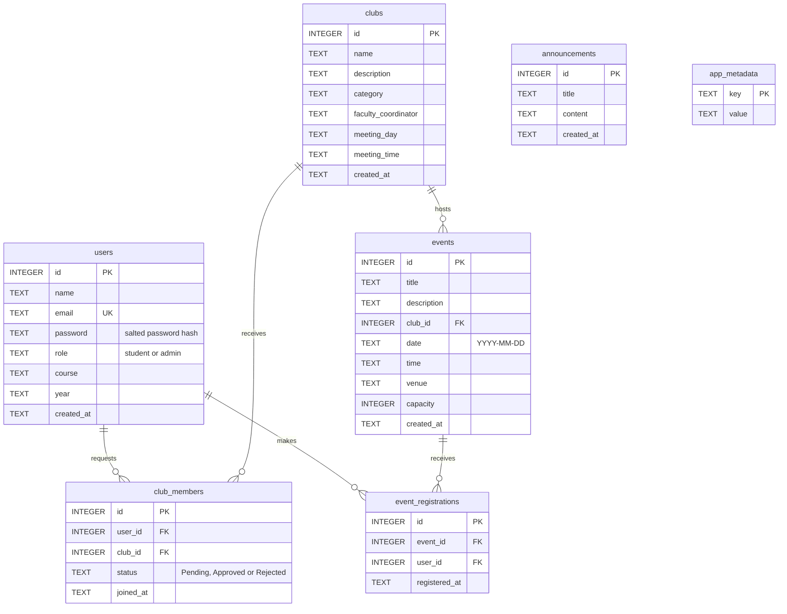

# Database design and operation

The app uses SQLite through Python's standard library. Data is stored in a local
file. `migrations/001_initial.sql` defines the schema, constraints, triggers and
indexes; `db_schema.py` handles initialization and migration. `database.py`
contains the application's database operations. No separate database server is
needed for a single-host installation.

## Data model



Announcements are college-wide and have no club or user foreign key. The original
UI stores the faculty coordinator as display text rather than an account reference.
The metadata table stores operational markers, including whether demo data has
already been seeded. `PRAGMA user_version` records the schema version, currently 1.

## Integrity rules

- User emails are normalized and unique without case distinctions. Roles are
  restricted to `student` and `admin`.
- A user has at most one membership record for each club, including pending and
  rejected requests. Status is restricted to `Pending`, `Approved` or `Rejected`.
- A user can register only once for an event. Foreign keys require referenced
  users, clubs and events to exist.
- Event capacity must be a nonnegative integer; zero closes registration.
  Registration cannot exceed capacity, and capacity cannot be reduced below the
  existing registration count.
- Names and titles cannot be blank. Event dates must be valid calendar dates in
  `YYYY-MM-DD` format. The application accepts new registrations only for events
  on or after today's date.
- Deleting a user deletes their memberships and registrations. Deleting a club
  deletes its memberships and events, including those events' registrations.
  Deleting an event deletes its registrations.

Unique constraints and triggers protect these rules in the database, including
when two requests arrive together. Registration uses a write transaction so its
duplicate/capacity checks and insert commit together. Indexes support common
membership, event and registration lookups. SQL values use parameterized queries.

Foreign keys are enabled on every application connection. External SQLite clients
must also execute `PRAGMA foreign_keys = ON` before modifying data. Prefer the app
and management commands to direct database edits.

## Passwords and administrator setup

New password hashes use PBKDF2-HMAC-SHA256 with 600,000 iterations, a random salt
per password and a versioned format. Password verification uses constant-time
comparison. Existing hashes from the original 100,000-iteration format remain
readable and are upgraded when that user successfully logs in.

Create an administrator on the server with:

```sh
python manage_db.py create-admin --email admin@college.edu --name "College Admin"
```

The command reads the password and confirmation from a hidden prompt and requires
at least 12 characters. Student self-registration requires at least 8 characters.
The app never creates a default admin. Database files and backups contain password
hashes and student data: restrict access to the app operator and backup operator.

Migration preserves existing accounts, including the old demo administrator if it
exists. Its previous shared password must be rotated before publishing an upgraded
installation. The server operator can reset an account without putting a password
in command history:

```sh
python manage_db.py reset-password --email admin@college.com
```

This command also uses a hidden password/confirmation prompt and a minimum length
of 12 characters. Substitute the intended account's email when resetting another
account.

## Initialization and migrations

`python manage_db.py init` and app startup both initialize the configured database.
They do not seed content or create accounts. Set `COLLEGE_DB_PATH` consistently for
the app and management commands; a relative value is resolved against the project
directory, not the current terminal directory. The default is
`college_management.db` beside `app.py`. `.env` files are not automatically read.

The original unversioned schema is treated as version 0. The migration:

1. Creates a consistent, uniquely named backup beside an existing legacy database:
   `<database-name>.pre-v1.<UTC timestamp>.<unique>.bak`.
2. Checks existing records before applying the stricter schema. Duplicate
   relationships, email collisions after normalization, invalid foreign keys and
   overbooked events require operator correction.
3. Copies valid records into the constrained schema while preserving IDs and
   relationships, then records version 1 in the same transaction.

A failed migration rolls back; it does not delete or silently merge invalid rows.
Subsequent startup at the current schema version does not reseed or repeat the
migration. A database from a newer schema version is rejected so older code cannot
silently alter it. Keep the versioned schema source in Git; never check a real
deployment's database into source control.

Optional `python manage_db.py seed-demo` inserts sample clubs, future events and
announcements once. It creates no users, rejects nonempty content tables, and
records a marker so repeated runs do not duplicate data.

## Backups and consistency checks

```sh
python manage_db.py check
python manage_db.py backup backups/college-backup.sqlite3
```

`check` inspects schema version, database integrity and foreign-key consistency.
It reports problems with a nonzero exit status. `backup` uses SQLite's backup API
to produce a consistent snapshot and refuses to overwrite the destination.

Use unique backup filenames and retain copies on another disk or storage service.
Test recovery on a separate database path. Write-ahead logging (WAL) can leave
recent commits in the `-wal` sidecar; copying only an active `.db` file is not a
reliable backup. Do not delete live `-wal` or `-shm` files.

## Recovery and troubleshooting

- **Migration rejected existing data:** stop the app, retain the original and its
  automatic backup, then inspect the detailed error from `python manage_db.py init`.
  Correct the identified records on a working copy after deciding which real
  records should remain. Run initialization and `check` on that copy before using
  it. Constraints intentionally reject ambiguous data instead of losing it.
- **Cannot open or write the database:** check `COLLEGE_DB_PATH`, available disk
  space and permissions for the containing directory. SQLite needs to write its
  database and journal sidecar files there.
- **Database is locked:** close long-running external write transactions. The app
  waits briefly for locks, but SQLite permits only one writer at a time. Persistent
  contention may require a server database.
- **Restore from backup:** stop the app and all writers. Copy a known-good backup to
  a new, unused database filename, set `COLLEGE_DB_PATH` to that file, run
  `python manage_db.py init` followed by `python manage_db.py check`, and restart
  using the same environment setting. Retain the old database and sidecars until
  recovery is verified. Restoring an older backup restores data only up to its time.
- **Newer schema version:** run the matching or newer application release instead
  of manually changing `PRAGMA user_version`.

## Hosting limits

Use persistent local storage on a single host. WAL and busy timeouts allow normal
concurrent app sessions but do not remove SQLite's single-writer limit. Network
filesystems and separate hosts sharing a database file are not supported here.
Ephemeral deployment disks can lose the database on restart or redeploy.

For multiple hosts or heavy concurrent writes, migrate the schema and database
access functions to a managed PostgreSQL service. This project does not include a
PostgreSQL adapter; an environment variable alone cannot change database engines.
